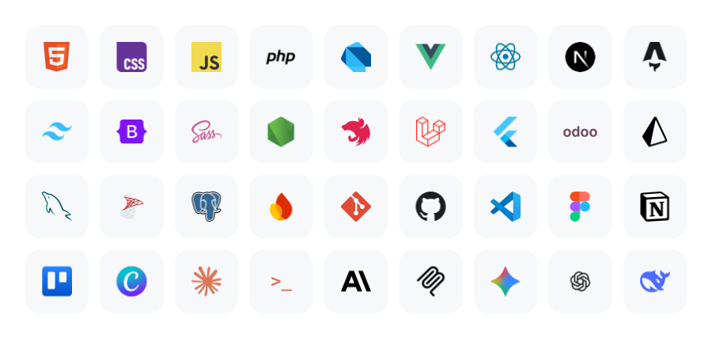

<picture><source media="(prefers-color-scheme: dark)" srcset="assets/perfil-dark.svg"></picture>

<a href="https://www.linkedin.com/in/jhordev"><picture><source media="(prefers-color-scheme: dark)" srcset="assets/link-linkedin-dark.svg"></picture></a>
<a href="mailto:jhordev.pe@gmail.com"><picture><source media="(prefers-color-scheme: dark)" srcset="assets/link-correo-dark.svg"></picture></a>
<a href="https://verify.skilljar.com/c/b4izch58n68k"><picture><source media="(prefers-color-scheme: dark)" srcset="assets/link-certificado-dark.svg"></picture></a>

<picture><source media="(prefers-color-scheme: dark)" srcset="assets/stack-dark.svg"></picture>

